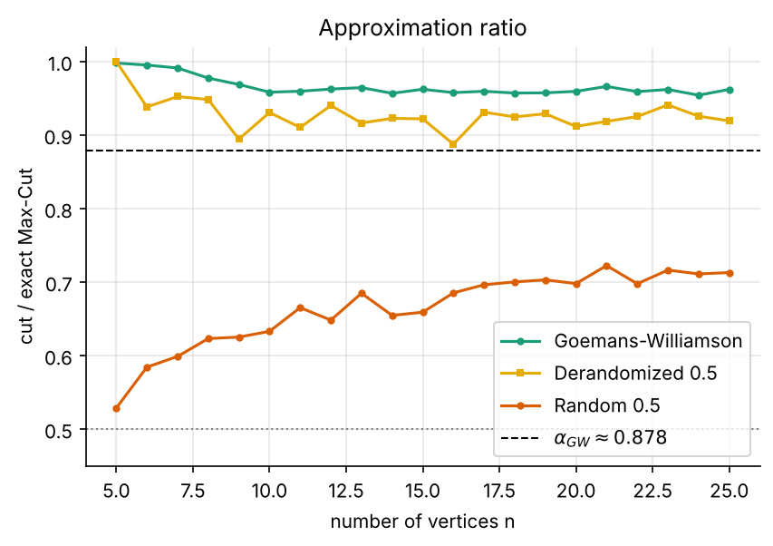
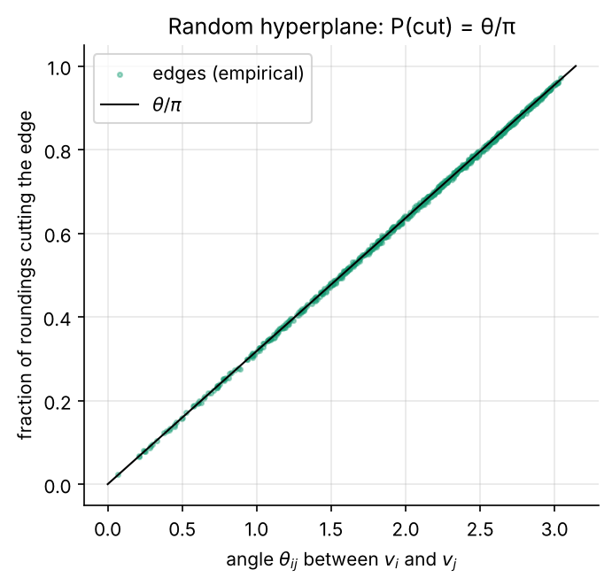

# Goemans–Williamson for Max-Cut

[](https://github.com/alberto-denicolo/maxcut-goemans-williamson/actions/workflows/ci.yml)


Code and experiments for my bachelor thesis *L'algoritmo di Goemans-Williamson per il MaxCut: analisi teorica e
implementazione computazionale* (University of Padova, 2024, supervisor Prof. Alberto Chiarini; in Italian).

The package implements exact Max-Cut by enumeration, the randomized 0.5-approximation and its derandomization, and
the Goemans–Williamson algorithm (semidefinite relaxation + random-hyperplane rounding). The experiments reproduce
chapter 5 of the thesis and add four new ones that look at *why* the algorithm works and how it behaves on graphs too
large to solve exactly.

## Main results

On Erdős–Rényi graphs with n = 5…25 vertices, compared with the exact optimum found by brute force
(10 graphs per n; the first three rows use p = 0.4 as in §5.3.2 of the thesis, the last one p = 0.5 as in §5.3.4):

| Algorithm | cut / OPT, mean | worst graph |
|---|---|---|
| Random cut (expected value, exactly \|E\|/2) | 0.662 | 0.500 |
| Derandomized 0.5-approximation | 0.928 | 0.750 |
| Goemans–Williamson, one rounding (mean of 10) | **0.966** | 0.915 |
| Goemans–Williamson, best of 10 roundings | **0.998** | 0.960 |

- Every graph stays above the worst-case guarantee α ≈ 0.878; on random graphs the algorithm is far from its worst case.
- Best of 10 roundings finds the exact optimum on 90% of the graphs, in 0.06 s at n = 25, against about 6 s for brute
  force (which doubles with every extra vertex).
- The probability that the hyperplane cuts an edge is exactly θ/π (θ = angle between the two SDP vectors): over 709
  edges and 20,000 roundings the empirical frequency is never more than 0.009 away from θ/π.
- Up to n = 200, where brute force is impossible, the best GW cut is within 6% of the SDP upper bound, so within 6% of
  the optimum. The SDP solve time grows roughly like n² in this range.

<p align="center">
  
  
</p>

## The algorithm in one paragraph

For a graph with weights w_ij, Max-Cut asks for x ∈ {−1, 1}ⁿ maximizing ¼ Σ w_ij (1 − x_i x_j). Goemans and Williamson
replace each sign x_i by a unit vector v_i and solve the semidefinite program

    max ¼ Σ w_ij (1 − X_ij)   subject to   X ⪰ 0,  X_ii = 1,     with X_ij = v_i · v_j,

whose value is an upper bound on the optimum. A random hyperplane through the origin then separates the vectors into
two groups: an edge is cut with probability θ_ij/π, and comparing θ/π with (1 − cos θ)/2 term by term gives
E[cut] ≥ 0.878 · SDP ≥ 0.878 · OPT.

## Quick start

```bash
git clone https://github.com/alberto-denicolo/maxcut-goemans-williamson.git
cd maxcut-goemans-williamson
python -m venv .venv && source .venv/bin/activate      # Windows: .venv\Scripts\activate
pip install -e ".[dev]"
```

Solve your own graph (one edge per line, `u v` or `u v weight`, vertices numbered from 0):

```bash
gwmaxcut solve examples/petersen.txt --rounds 200
```

```
vertices: 10   total weight: 15
SDP upper bound:   12.5000
expected GW cut:   10.9842
best cut found:    12.0000  (0.960 of the bound)
side S: 1 2 4 5 8 9
```

From Python:

```python
import numpy as np
from gwmaxcut import erdos_renyi, goemans_williamson, brute_force

rng = np.random.default_rng(0)
W = erdos_renyi(20, 0.5, rng)  # dense symmetric weight matrix
res = goemans_williamson(W, n_rounds=100, rng=rng)
print(res.sdp_value, res.best_cut, brute_force(W)[0])
```

## Reproducing the experiments

```bash
make quick          # every experiment on small sizes, about 1 minute
make all            # full thesis configuration: about 7 minutes on a laptop, then all figures
```

`make all` runs `gwmaxcut run all --config configs/thesis.yaml` and `gwmaxcut plot`. Every parameter (sizes, edge
probability, number of graphs and roundings, seed) is in [`configs/thesis.yaml`](configs/thesis.yaml); results are
written as CSV to `results/` and figures to `figures/`. Graph *g* of size *n* in each experiment is generated from its
own seed, so any row of a results file can be recomputed on its own.

| Experiment | Thesis | Question | Figure |
|---|---|---|---|
| `runtime` | §5.3.1 | How does the running time grow with n? | [runtime](figures/runtime.png) |
| `approximation` | §5.3.2 | How close are the approximations to the exact optimum? | [values](figures/approximation_values.png), [ratio](figures/approximation_ratio.png) |
| `gw_bound` | §5.3.3 | Does the average GW ratio stay above 0.878? | [bound](figures/gw_bound.png), [running mean](figures/gw_running_mean.png) |
| `best_of_k` | §5.3.4 | What does keeping the best of 10 roundings buy? | [ratio](figures/best_of_k.png), [time](figures/best_of_k_time.png) |
| `rounding_law` | new | Is P(edge is cut) really θ/π? | [rounding_law](figures/rounding_law.png) |
| `large_n` | new | How good are the cuts when brute force is impossible (n ≤ 200)? | [large_n](figures/large_n.png), [sdp_time](figures/sdp_time.png) |
| `density` | new | How do the GW ratio and the SDP gap depend on p? | [density](figures/density.png) |
| `best_of_t` | new | How many roundings are worth doing? | [best_of_t](figures/best_of_t.png) |

## Repository layout

```
src/gwmaxcut/
    graphs.py        graph generators and edge-list reader (dense weight matrices)
    cut.py           cut value of one or many partitions
    exact.py         brute force over the 2^(n-1) partitions, vectorized in blocks
    heuristics.py    random cut, derandomized cut (conditional expectations), 1-flip local search
    gw.py            SDP relaxation (CVXPY), Gram vectors, hyperplane rounding, exact expected cut
    experiments.py   the eight experiments
    plotting.py      figures
    cli.py           `gwmaxcut run | plot | solve`
configs/             thesis.yaml (full) and quick.yaml (CI)
results/             CSV output of the full run
figures/             PNG figures used in this README
tests/               unit tests, including closed-form checks
examples/            a small edge list (Petersen graph)
```

## Implementation notes

- **Gram vectors.** The vectors are v_i = rows of U·√Λ from the eigendecomposition X = UΛUᵀ, with tiny negative
  eigenvalues (solver noise) set to zero. Using the eigenvectors without the √Λ scaling, as in the appendix of the
  thesis, gives vectors whose inner products are not X; the rounding then loses its guarantee.
- **One SDP, many roundings.** The SDP is solved once per graph and the rounding is repeated. This is equivalent to
  rerunning the whole algorithm, as was done in the thesis, and much cheaper.
- **Exact expectation.** `expected_cut` computes Σ w_ij arccos(X_ij)/π, the exact mean of one rounding, so the ratio
  E[GW]/OPT is known without simulation; the simulated running mean converges to it (figure `gw_running_mean`).
- **Solvers.** Clarabel is used up to n = 100 and SCS above: on some sparse graphs with n ≈ 150 Clarabel needed more
  than 8 GB of memory, while SCS solves them in under a second. The `large_n` experiment uses SCS for all sizes so that
  timings are comparable.
- **Operation counts.** The thesis plotted an estimated number of operations; here only measured wall-clock times are
  reported, together with the number of partitions examined by brute force.

## Tests

```bash
make test     # pytest
make lint     # ruff
```

The tests check, among other things: the SDP value of the 5-cycle, (25 + 5√5)/8, the classical example where
OPT/SDP ≈ 0.884; that bipartite graphs are solved exactly; brute force against a naive enumeration;
SDP ≥ OPT ≥ GW cut on random graphs; that the mean of many roundings matches the exact expectation; that the
derandomized cut always reaches half the total weight; and that local search ends in a 1-flip optimum.

## References

- M. X. Goemans, D. P. Williamson. Improved approximation algorithms for maximum cut and satisfiability problems using
  semidefinite programming. *Journal of the ACM* 42(6), 1995. doi:10.1145/227683.227684
- D. P. Williamson, D. B. Shmoys. *The Design of Approximation Algorithms*. Cambridge University Press, 2011.
- S. Khot, G. Kindler, E. Mossel, R. O'Donnell. Optimal inapproximability results for MAX-CUT and other 2-variable
  CSPs? *SIAM Journal on Computing* 37(1), 2007.

## Citation and license

If this code is useful to you, please cite it using [`CITATION.cff`](CITATION.cff) (GitHub shows a "Cite this
repository" button). Released under the [MIT license](LICENSE).

Alberto De Nicolò · [LinkedIn](https://linkedin.com/in/alberto-denicolo)
